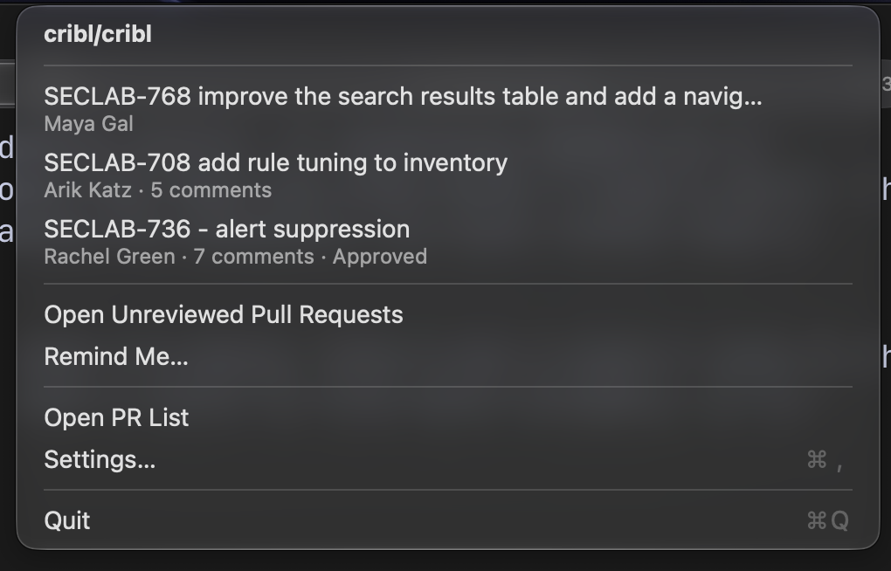
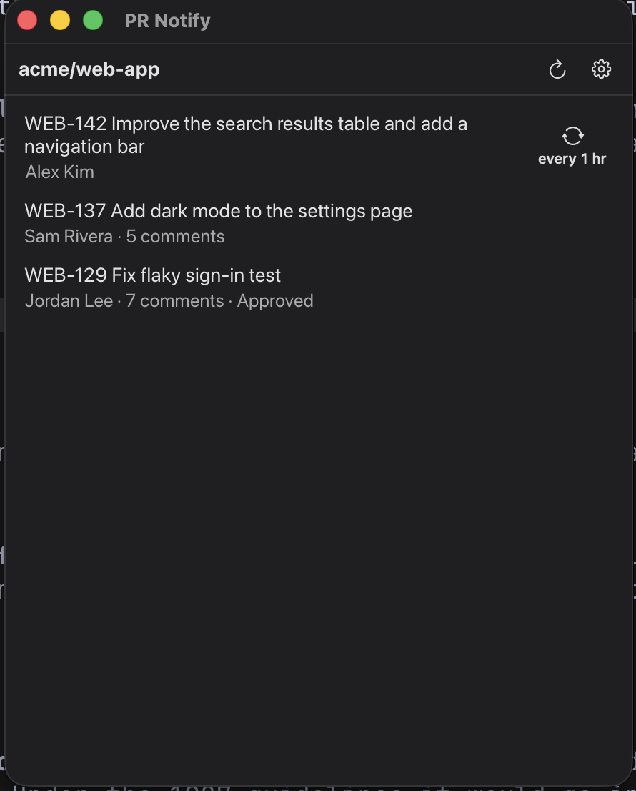
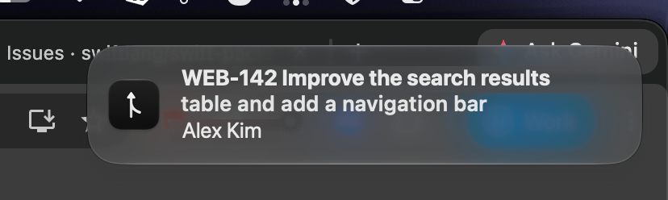

# Bitbucket PR Notifier

A macOS menu bar app that tells you when a Bitbucket pull request is waiting for
your review, and reminds you until you get to it.

<p>
  
  
</p>
<p>
  
</p>

- See every open PR where you're a reviewer, with your comments and approvals.
- Get a notification as soon as a new one is assigned to you.
- **Remind Me…** about any PR at a set time, or nag every few minutes until it's merged.
- **My Pull Requests**: your own open PRs, with each reviewer's state (waiting, commented,
  approved, changes requested). **Nag Mergers…** messages the repo's mergers on Slack now,
  at a set time, or every few hours until the PR is merged.
- **Ask to Merge…**: for repos where only some people can merge. Turn it on per repository
  in Settings and list who merges; when a PR of yours is first approved ("Rachel Green has
  approved …"), you pick one and they get a Slack message.
- A notification when one of your PRs is merged.
- Checks GitHub for a new version at launch and daily; **Check for Updates…** in the menu.

## Install

Requires macOS 14 or later and the Xcode Command Line Tools (`xcode-select --install`).

```sh
./scripts/build-app.sh
open "build/Bitbucket PR Notifier.app"
```

Drag `build/Bitbucket PR Notifier.app` to `/Applications` to keep it. If you got a zipped copy
from a teammate instead, run this once so macOS lets it open:

```sh
xattr -dr com.apple.quarantine "/Applications/Bitbucket PR Notifier.app"
```

## Sign in

### With an API token (recommended)

1. Open [Atlassian API tokens](https://id.atlassian.com/manage-profile/security/api-tokens)
   → **Create API token with scopes** → **Bitbucket**.
2. Tick these scopes: `read:user:bitbucket`, `read:workspace:bitbucket`,
   `read:repository:bitbucket`, `read:pullrequest:bitbucket`.
3. In Bitbucket PR Notifier → **Settings…**, enter your Atlassian email and the token, then pick a repository.

The token is saved on your Mac, readable only by your user account. When it
expires, Bitbucket PR Notifier asks you to sign in again.

### With your browser

**Sign in with Bitbucket** appears in Settings only in builds made with an OAuth
consumer; see [docs/DEVELOPMENT.md](docs/DEVELOPMENT.md).

## Slack (for nagging mergers and asking to merge)

The app can send DMs **as you** with a Slack app's user token, or through a Slack workflow
(sent by the workflow, no app or token needed).

### As you (user token)

1. At api.slack.com/apps, create an app for your workspace.
2. Under **OAuth & Permissions → User Token Scopes**, add `im:write` and `chat:write`.
3. **Install to Workspace** (an admin may need to approve), then copy the **User OAuth Token** (`xoxp-…`).
4. In **Settings…** → **Slack** tab, paste it into **User Token**. It's kept in the Keychain and
   wins over the webhook.

### Through a workflow (webhook)

Set it up once:

1. In Slack: **Tools → Workflow Builder → New workflow → From a webhook**.
2. Add two variables: `user_id` (type **Slack user ID**) and `message` (type **Text**).
3. Add the step **Send a message to a person**, choosing `user_id` as the person and `message`
   as the text. Publish, and copy the webhook URL.
4. In Bitbucket PR Notifier → **Settings…** → **Slack** tab, paste the URL.

Then add the people who can merge, with their Slack member IDs (profile → ⋯ → **Copy member
ID**), under **Merging in** *repository*.

To look up member IDs, enter the names, then use **Find Member IDs with AI** on the Slack tab:
copy its prompt into an AI assistant that can search your Slack (such as Claude with Slack
connected), copy the answer, and click **Paste Member IDs**.

With no webhook, the app copies the message and opens the person's DM in Slack for you to
paste. To open the DM, fill in **Workspace ID** (T…). Scheduled nags then arrive as a
notification for you to click. They're sent only while the app is running.
