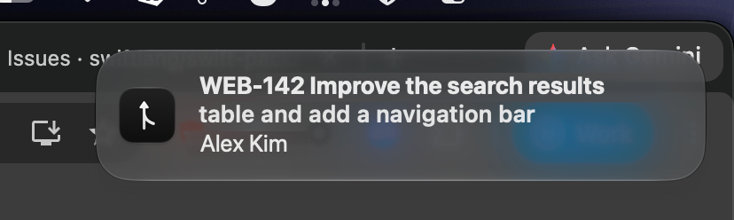

# Bitbucket PR Notifier

A macOS menu bar app that tells you when a Bitbucket pull request is waiting for
your review, and reminds you until you get to it.

<p>
  
  
</p>
<p>
  
</p>

- See every open PR where you're a reviewer, with your comments and approvals.
- Get a notification as soon as a new one is assigned to you.
- **Remind Me…** about any PR at a set time, or nag every few minutes until it's merged.
- Checks GitHub for a new version at launch and daily; **Check for Updates…** in the menu.

## Install

Requires macOS 14 or later and the Xcode Command Line Tools (`xcode-select --install`).

```sh
./scripts/build-app.sh
open "build/Bitbucket PR Notifier.app"
```

Drag `build/Bitbucket PR Notifier.app` to `/Applications` to keep it. If you got a zipped copy
from a teammate instead, run this once so macOS lets it open:

```sh
xattr -dr com.apple.quarantine "/Applications/Bitbucket PR Notifier.app"
```

## Sign in

### With an API token (recommended)

1. Open [Atlassian API tokens](https://id.atlassian.com/manage-profile/security/api-tokens)
   → **Create API token with scopes** → **Bitbucket**.
2. Tick these scopes: `read:user:bitbucket`, `read:workspace:bitbucket`,
   `read:repository:bitbucket`, `read:pullrequest:bitbucket`.
3. In Bitbucket PR Notifier → **Settings…**, enter your Atlassian email and the token, then pick a repository.

The token is saved on your Mac, readable only by your user account. When it
expires, Bitbucket PR Notifier asks you to sign in again.

### With your browser

**Sign in with Bitbucket** appears in Settings only in builds made with an OAuth
consumer; see [docs/DEVELOPMENT.md](docs/DEVELOPMENT.md).
